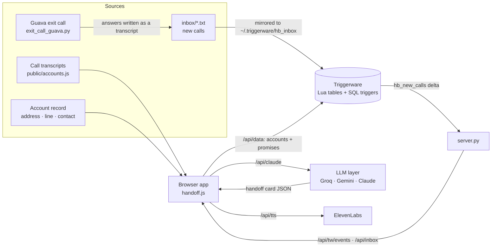

# Handoff Brain

**The company brain that keeps your word.**

When a teammate changes roles, goes on leave or quits, their customers get handed to someone new. What was actually said and promised lives in hours of call recordings that nobody has time to read, so promises slip and customers notice first.

Handoff Brain reads every call a departing teammate had and gives the person who inherits the accounts a plan they can act on Monday morning.

Built at the TechEquity Ai Company Brain Hackathon (Nov 4, 2026, Snowflake SVAI, Menlo Park). All demo data (clinics, people, addresses, phone numbers) is fictional; the vendor is a made-up company called "Northwind."

## What it does

| Feature | How it works |
|---|---|
| **Read everything in 60 seconds** | An LLM reads every call transcript for every inherited account and marks each one red, amber or green with a one-sentence reason. |
| **Start here** | The landing page for the new owner: first moves across every account, most urgent first, each with the reason why. |
| **Handoff cards** | Onboarding journey, risks, promises, next-call plan and a CRM-ready note, with the account record (address, main line, primary contact) next to what was said on calls. |
| **✓ Verified receipts** | Every quote is checked word for word against the real transcript in code. If it isn't there, it doesn't get the badge. |
| **Ask anything, two modes** | History questions are answered only from the record and calls, with the quote. "What should I do?" questions get the brain's own advice, clearly labeled as a recommendation. |
| **Promise Radar** | Promises we broke, promises we owe, what customers owe us, and what we kept. "Keep the promise" drafts the follow-up. |
| **Real phone exit call** | A Guava voice agent phones the departing teammate and asks what their notes are missing. Answers are written back as call transcripts. |
| **Hands-free ingestion** | New transcripts land in `inbox/`; a Triggerware trigger sees them and the matching account re-reads itself. No pasting. |
| **Product Insights** | Patterns across every call, in customers' own words, for product managers. |
| **Brief me in 60s** | ElevenLabs voice briefing per account. |

## How it works



### 1. Reading the calls → a handoff card
For each account, the browser sends every call transcript to `/api/claude`. The server forwards it to the configured LLM (keys never reach the browser). The prompt tells the model to use **only** what the transcripts say, copy quotes exactly, and mark a promise **overdue** only when the call said it should already have happened (for example "right after this call") and no later call confirms it. The model returns strict JSON:

```json
{
  "health": "red | amber | green",
  "health_reason": "where the account stands and the single biggest reason",
  "stage": "current onboarding step",
  "facts": {"pms": "…", "integration": "yes | csv | pending | no", "contacts": [{"name": "…", "role": "…"}]},
  "journey": [{"step": "Kickoff", "status": "done | in_progress | blocked | todo", "note": "…"}],
  "where_it_stands": ["3 short bullets"],
  "risks":    [{"text": "…", "quote": "exact words", "call": "May 6"}],
  "promises": [{"who": "us | customer", "text": "…", "due": "date or 'Overdue: …'", "quote": "exact words", "call": "May 6"}],
  "next_call": ["3-5 concrete actions"],
  "summary_60s": "spoken briefing (~110 words)",
  "crm_note": "Salesforce-ready activity note"
}
```

All accounts are read in parallel when you click **Read everything**. Results are cached on the server (`/api/cache/*`), so reloads are instant. If the LLM is down or slow, each account falls back to a prepared card, so the demo never breaks.

### 2. ✓ Verified receipts (no hallucinated quotes)
Every quote the model returns is checked **in code, not by the model**. The quote and the account's transcripts are normalized (lowercase, punctuation stripped). If the whole quote appears, it's verified. For longer quotes we allow light paraphrase at the edges: every overlapping 6-word window must appear verbatim. Anything else shows **⚠ not found verbatim** instead of the green badge.

### 3. Start here: ranking the first moves
Each account gets a score: `red = 100`, `amber = 50`, plus `20` per broken promise and `3` per risk. Promises marked kept are excluded. Accounts are sorted by score, and each shows its single most important move, the reason, and **Keep the promise** if something is overdue.

### 4. Promise Radar
Every promise from every card is classified:
- **broken**: we owe it and it's overdue
- **due**: we owe it, not yet due
- **theirs**: the customer owes us (bill, PIN, IT access)
- **kept**: marked done by the new owner

**Keep the promise** asks the LLM to draft the follow-up email from the promise, its quote and the transcripts. It never invents a status or result it doesn't know: unknowns are left in `[square brackets]` for the sender to fill in. **Mark kept** stores it so it drops off the radar and out of the ranking.

### 5. Ask anything: facts vs. advice
The chat sends the account record plus every transcript with the question. The model must answer facts only from those sources, with an exact quote, which is then run through the same verifier. When the question asks *what to do*, the model may add its own recommendations in a separate `advice` list, shown in a purple box labeled **Brain's recommendation (not from the calls)**. Facts and advice never mix.

### 6. Hands-free call ingestion (Triggerware)
1. A new transcript lands in `inbox/` (from a call recorder, or from the Guava exit call). The first line is a header: `Clinic · Date · Title · N min`.
2. `server.py` mirrors it into `~/.triggerware/hb_inbox/`.
3. The Triggerware table `hb_calls` is a Lua generator that lists that folder. The standing trigger `hb_new_calls` (`SELECT file FROM hb_calls`, polled every 5 seconds) fires a delta when a new file appears.
4. The server watches the trigger with the Python SDK and relays deltas to the browser (`/api/tw/events`). The app fetches the file, matches it to an account by clinic name (falling back to the LLM if unclear), appends the call, and re-reads that account. The card updates, sometimes changing color.

The browser also writes the live accounts and promises back to `~/.triggerware/hb_data/*.json`, where the Lua tables `hb_accounts` and `hb_promises` read them. Two more standing triggers watch those: `hb_at_risk_accounts` (`WHERE health = 'red'`) and `hb_open_promises` (`WHERE owner = 'us'`). Their deltas appear as **Live alerts** in the sidebar.

### 7. Real phone exit call (Guava)
`exit_call_guava.py` uses the Guava SDK:
1. `agent.call_phone()` dials `EXIT_CALL_TO` from your Guava number.
2. `reach_person()` greets the departing teammate. If they're available, `set_task()` gives the agent a checklist of questions, one per knowledge gap (for example the overdue Lakeview texting promise).
3. When the checklist is complete, each answer is read with `get_field()` and written to `inbox/` as a call transcript, which flows through the same Triggerware pipeline above. The accounts update without anyone typing.

The **📞 Call Maya** button in the app can start the same script (`--app` mode). The script writes live status to `.calls/<id>.json`, which the app polls to show the conversation. Without Guava configured, the button runs a browser version of the interview.

### 8. Product Insights
The LLM reads every call across every account and groups recurring problems into themes (product friction, process gap, expectation gap, feature request). Each theme lists which accounts it hit, customer quotes (verified the same way), and a suggested fix you can copy as a ticket.

### 9. LLM provider layer
`server.py` speaks the Anthropic API and the OpenAI-compatible chat format, so switching between **Groq**, **Gemini** and **Claude** is one line in `.env` (`LLM_PROVIDER`). Requests retry with backoff on 429/5xx. If the provider says a model doesn't exist, the server lists the provider's models, picks an available one and retries.

### Files
| File | What it is |
|---|---|
| `server.py` | Zero-dependency Python server: LLM proxy, ElevenLabs proxy, inbox mirror, Triggerware watcher, Guava launcher |
| `public/handoff.js` | The app: analysis, verification, ranking, radar, chat, inbox ingestion, exit call |
| `public/accounts.js` | Fictional demo accounts, transcripts and prepared fallback cards |
| `tw_setup.py` | Creates the Triggerware tables and triggers (run once) |
| `exit_call_guava.py` | Real outbound exit call with Guava |
| `samples/lakeview-followup.txt` | A follow-up call to drop into `inbox/` to see an account change live |
| `SPEC.md` | The AppStarter-generated spec |

## Stack
- **Triggerware** (local server + Python SDK): Lua tables over the brain's live data (accounts, promises, call inbox) and standing SQL triggers (`hb_new_calls`, `hb_at_risk_accounts`, `hb_open_promises`, …)
- **AppStarter**: generated the build spec (see `SPEC.md`)
- **Guava** (`guava-sdk`): outbound exit call on a real phone line (`exit_call_guava.py`)
- **LLM**: provider-agnostic, OpenAI-compatible layer: Groq, Gemini or Claude (`LLM_PROVIDER`). If a model is retired, the server picks an available one.
- **ElevenLabs**: text-to-speech briefings
- Front end: plain HTML/JS. Back end: Python standard library server that keeps every API key off the browser.

Every AI feature falls back to a prepared summary, so the demo keeps working if a model is overloaded.

## Run it
```sh
# 1. Triggerware (macOS)
curl -fsSL https://tw2-releases.s3.us-east-2.amazonaws.com/install.sh | sh
curl -fsSL https://tw2-releases.s3.us-east-2.amazonaws.com/cli/install.sh | sh
triggerware start
pip3 install triggerware guava-sdk

# 2. Keys
cp .env.example .env
#   LLM_PROVIDER=groq  and  GROQ_API_KEY=...   (or GEMINI_API_KEY / ANTHROPIC_API_KEY)
#   ELEVENLABS_API_KEY=...                       (optional, voice briefings)
#   GUAVA_API_KEY=...  GUAVA_AGENT_NUMBER=+1...  EXIT_CALL_TO=+1...   (optional, real phone call)

# 3. One-time Triggerware tables + triggers
python3 tw_setup.py

# 4. Start
./run.sh                      # opens http://localhost:8787

# 5. Real exit call (in another terminal)
python3 exit_call_guava.py
```

## Demo
1. **Read everything in 60 seconds** → every account gets a verdict.
2. **Start here** → first moves, most urgent first.
3. Open **Lakeview Family Dental** → handoff card, click a ✓ verified quote.
4. Ask *"What did Maya promise Rosa?"*, then on Harbor Point ask *"What should I ask the carrier?"*
5. **Promise Radar** → **Keep this promise**.
6. Run `python3 exit_call_guava.py` → your phone rings → answer as Maya → the accounts update.
7. **Product Insights** → patterns across accounts.
